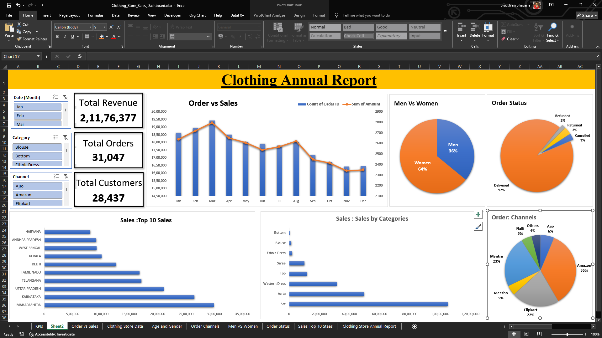

# 👗 Clothing Store Sales Dashboard (Excel)

An interactive Excel dashboard analyzing annual sales performance of an
online clothing store across marketplaces such as Amazon, Myntra, Flipkart and Ajio.

## 📌 Objective
Turn raw order data into insights on revenue, customer behavior, sales channels and
regional performance to support business decisions.

## 📊 Dataset
- ~31,000 orders (Dec 2022 onward)
- Fields: Order ID, Customer ID, Gender, Age / Age Group, Date, Month, Status,
  Channel, SKU, Category, Size, Quantity, Amount, Ship State and more

## 🛠️ Tools & Techniques
- Microsoft Excel
- Data cleaning and preparation
- PivotTables and the Data Model (distinct counts via DAX measures)
- Slicers for interactive filtering
- Charts, KPI cards and dashboard design

## 🔍 Key Questions Answered
- What are total revenue, total orders and total customers?
- How do orders and sales trend month by month?
- Which sales channels drive the most orders?
- Do men or women generate more revenue?
- Which age groups buy the most?
- Which 10 states contribute the most sales?
- What share of orders are delivered, cancelled or refunded?

## 💡 Key Insights
- Women account for about 69% of orders and about 64% of revenue
  (₹1.36 Cr vs ₹0.76 Cr for men)
- Amazon is the largest channel at about 35% of orders, followed by Flipkart at about 22%
- Maharashtra, Karnataka and Uttar Pradesh are the top 3 states by revenue
- About 92% of orders are delivered; cancellations and refunds are about 4–5%
- Ethnic Dress is a top-selling category

## 📁 Files
| File | Description |
|---|---|
| `Clothing_Store_Data_Analysis.xlsx` | Full workbook: raw data, pivots, dashboard |
| `screenshots/` | Dashboard previews |

## 🚀 How to Use
Download the `.xlsx` file and open it in Excel (2016 or later). Use the slicers on
the dashboard sheet to filter the data.

## 👤 Author
Hokage · [LinkedIn](www.linkedin.com/in/ayush-nirbhavane)
